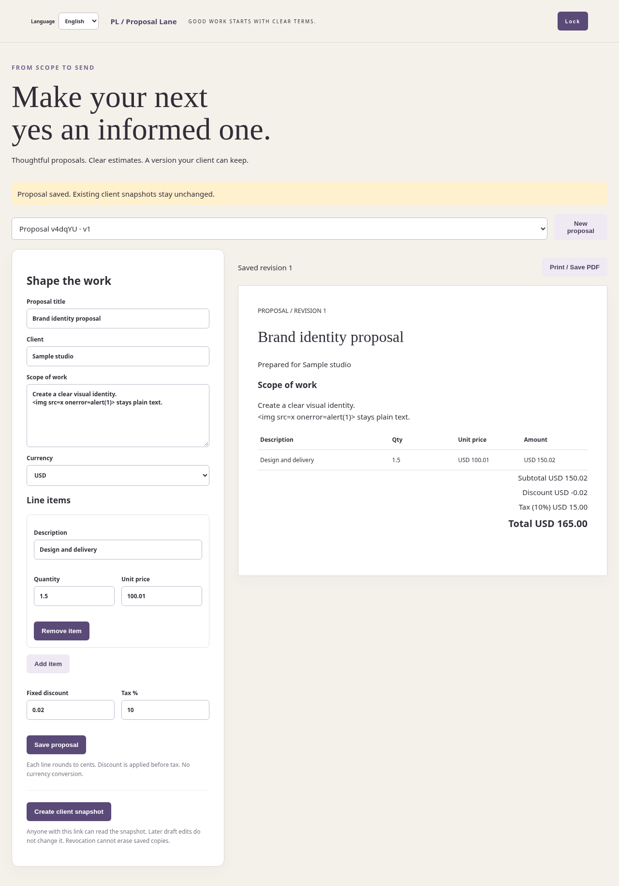

# Proposal Lane

**An open-source alternative for Better Proposals workflows, in preparation.**

Local six-language browser preview with a proposal editor, immutable client snapshots and browser Print / Save PDF. Native-speaker review and public HTTPS acceptance remain; no public release or deployment.

Implemented: line items with fractional quantities, explicit currency, fixed discount, tax percentage, exact cents, optimistic revision checks, immutable shared snapshots and revocable hashed share credentials. Run `python3 -m unittest discover -s tests -v` with Python 3.12; install `requirements.txt` first to include the HTTP tests.

Amounts accept plain decimal strings. Each line is rounded half-up to cents; the fixed discount is subtracted from the rounded subtotal; tax is rounded half-up on the discounted subtotal. Only USD, EUR, GBP, CAD and AUD are supported initially, all at two decimal places. Currency conversion and jurisdiction-specific tax compliance are not provided. Limits: 100 line items, quantity up to 1 million, unit price up to 1 million, subtotal up to 1 billion currency units. Zero-price items are allowed; zero quantity is not.

Owner library methods require authentication; the included `server.py` supplies that boundary. Share keys confer read access; they do not establish identity, consent, signature or payment. Revocation cannot erase copies already downloaded. The development API binds to localhost only.

English, German, Spanish, Japanese, Simplified Chinese and Traditional Chinese now pass browser language checks. Local persistent deployment and backup recovery pass.

[Scope and primary references](docs/SCOPE.md) · [MIT license](LICENSE)

[Run the authenticated local API](docs/API.md). Twenty tests cover calculations, immutable snapshots, access boundaries, stale revisions, revocation and request limits.

Start the local server using [API instructions](docs/API.md), then open http://127.0.0.1:8095. Save a proposal to preview its calculated totals. Create a client snapshot and copy its private link. Links pointing to localhost only work on the same computer; remote sharing requires an authorized HTTPS deployment. Use **Print / Save PDF** in the browser; turn off browser-added headers/footers when exporting. This is browser printing, not a server-generated PDF download.

Chromium acceptance covers exact totals, literal rendering of HTML-like text, immutable snapshots after edits, revocation, narrow layout and a one-page PDF with the expected proposal text/totals and without editor controls. A 28-page Chromium stress fixture also passes all content/total/page-bound checks; other browser print engines remain unverified. See [print acceptance](docs/PRINT.md).

[Persistent hosting and backup recovery](docs/DEPLOYMENT.md) provides private setup, non-root Docker and a localhost Compose service. Local container acceptance verifies draft revisions, immutable snapshots and revoked links across restart and clean-volume restoration, plus new edits and shares after recovery.

Language switching preserves drafts, proposal content and exact prices. Regional preferences, saved selection, blocked browser storage, translated errors and mobile layout are tested. Native-speaker review and public HTTPS remain pending. [Runnable preview and publication handoff](HANDOFF.md).
