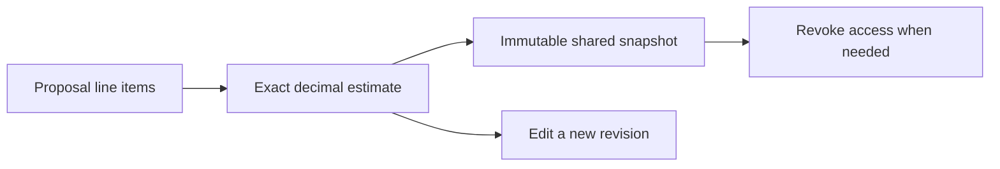

# Proposal Lane · development core

**An open-source alternative for Better Proposals workflows, in preparation.**

Local authenticated API preview. The browser editor and printable PDF workflow are not implemented yet. This is not a usable product release.

Implemented: line items with fractional quantities, explicit currency, fixed discount, tax percentage, exact cents, optimistic revision checks, immutable shared snapshots and revocable hashed share credentials. Run `python3 -m unittest discover -s tests -v` with Python 3.12; install `requirements.txt` first to include the HTTP tests.

Amounts accept plain decimal strings. Each line is rounded half-up to cents; the fixed discount is subtracted from the rounded subtotal; tax is rounded half-up on the discounted subtotal. Only USD, EUR, GBP, CAD and AUD are supported initially, all at two decimal places. Currency conversion and jurisdiction-specific tax compliance are not provided. Limits: 100 line items, quantity up to 1 million, unit price up to 1 million, subtotal up to 1 billion currency units. Zero-price items are allowed; zero quantity is not.

Owner library methods require authentication; the included `server.py` supplies that boundary. Share keys confer read access; they do not establish identity, consent, signature or payment. Revocation cannot erase copies already downloaded. The development API binds to localhost only.

Next: polished editor/client preview, safe print/PDF output, six interface languages, real browser acceptance and persistent deployment recovery.

[Scope and primary references](docs/SCOPE.md) · [MIT license](LICENSE)

[Run the authenticated local API](docs/API.md). Twenty tests cover calculations, immutable snapshots, access boundaries, stale revisions, revocation and request limits.
